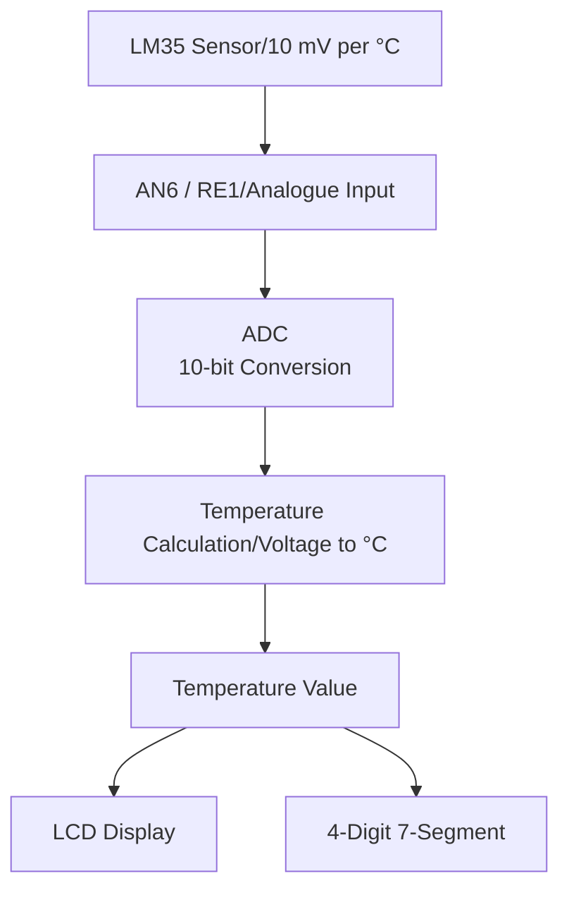
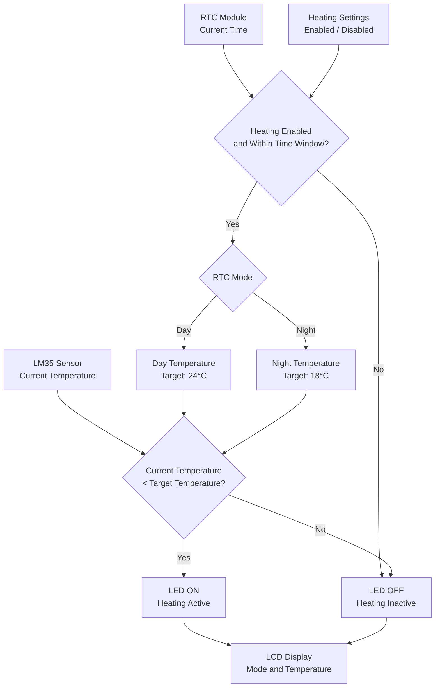

# LM35 Temperature Sensor


# Control Heating LED (Light Emmitting Diode)



# Real-Time Clock (RTC)

```mermaid
flowchart
```

# User Interface (UI)

```mermaid
flowchart
```

# EEPROM

```mermaid
flowchart
```

# Alarm and Buzzer 

```mermaid
flowchart
```

# File Structure

```mermaid
flowchart
```