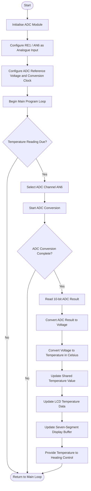
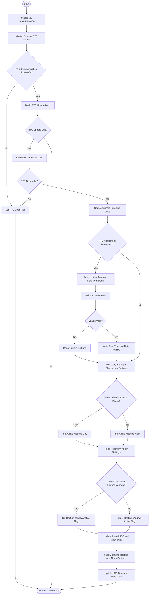
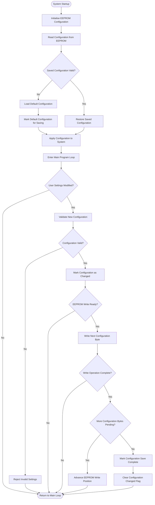
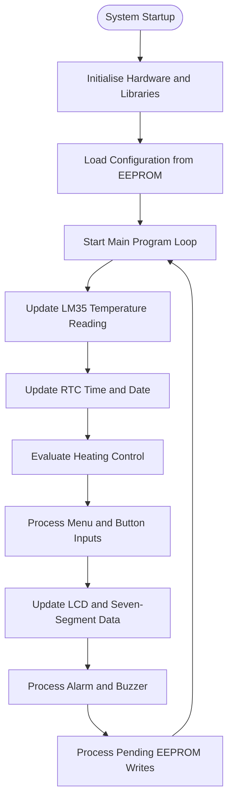

# Reece 
## 1. Tempreature Measurement (LM35 Sensor)
### Requirments:
1. Read LM35 Temperature sensor to AN6/RE1
2. Convert ADC reading int Degrees Celsius
3. Privide Temperature to LCD
4. Continuously monitor temperature without blocking other system functions.



```
As the EasyPic PIC18F45K22 usese internal ADC analouge values produced, 
approximately 10 mV per degree.
If ADC conversion is not complete the program will check during iteration.
```

## 3. Real Time Clock (LED Indicator)
### Requirments:
1. Communicate with an external RTC module, such as the Click16 board.
2. Read the current time and date.
3. Allow the user to adjust the RTC time and date.
4. Support adjustable Day/Night changeover times.
5. Support adjustable heating-window start and end times.
6. Supply accurate time information to the heating-control and alarm systems.



```
As the RTC module act indepenantly from the PIC18F45K22 maintains the current time and date.
As the microcontroller communicates with it using I²C as seen by the table:
```
| Setting | Example Value |
|---|---|
| Day Mode Start | 07:00 |
| Night Mode Start | 21:00 |
| Heating Window Start | 06:30 |
| Heating Window End | 08:00 |

```
At 07:30, Day mode would be active, and the system would be inside the heating window.

At 22:00, Night mode would be active, but the heating window would be inactive.

RTC communication and menu adjustments must not prevent temperature readings,
LED updates or alarm operation. The final implementation should use short,
scheduled operations or a non-blocking communication state machine where necessary.
```

## 5 EEPROM (Save Settings)

### Requirments:
1. Store user-configurable settings in EEPROM.
2. Restore the saved settings when the system starts.
3. Preserve settings after a power cycle.
4. Define which EEPROM addresses store individual settings.
5. Avoid unnecessary writes and blocking operations.
6. Keep the current time and date in the external RTC rather than duplicating them in EEPROM.



``` 
EEPROM stores the settings and users configurations through the menu,
unlike RAM EEPROM retains the contents and data after the microcontrikker loses power.

Upon startup the loaded program reads the stored configuration and checks against valid records.

If it is invalid or has not been saved/set the program loads default values. 

When the user updates the congiguration becomes valid, with the updated values
saved to EEPROM.

EEPROM writes should be performed only when necessary and should not introduce long blocking delays. The firmware can track pending writes and check their completion during successive main-loop iterations.
```

## Intergration

# Wiktor
## 2. Heating Control (LED Indicator)

## 4. Menu and Burrons (User Interface)

## 6. Alarm and Buzzer

## Intergration